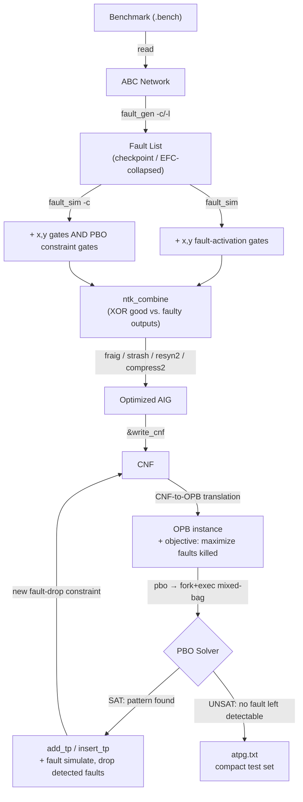

[](https://github.com/xNTsai/SAT-based-ATPG/actions/workflows/build-posix.yml)
[](https://github.com/xNTsai/SAT-based-ATPG/actions/workflows/build-windows.yml)
[](https://github.com/xNTsai/SAT-based-ATPG/actions/workflows/build-posix-cmake.yml)
[](https://github.com/berkeley-abc/abc)

# Incremental PBO-Based SAT ATPG

**A SAT/Pseudo-Boolean-Optimization ATPG engine, embedded directly into UC Berkeley's ABC as a set of new native commands.**

Given a gate-level circuit, this project generates a *minimal* set of test patterns that fully covers all detectable single stuck-at faults — by encoding the entire fault list as one incremental SAT problem and letting a Pseudo-Boolean Optimization (PBO) solver pick, at every iteration, the single input vector that kills the most remaining faults. The same fault-modeling infrastructure is then reused to solve the inverse problem: given a set of failing test responses, diagnose which gate is actually broken.

This was built as the final project for NTU's **113-2 VLSI Testing** course. The full methodology, formal problem encoding, and experimental results are written up in [`report.pdf`](./report.pdf); this README summarizes it and documents how to build and run the tool.

---

## Table of Contents

- [Why](#why)
- [What We Built](#what-we-built)
- [Architecture](#architecture)
- [New ABC Commands](#new-abc-commands)
- [Fault Diagnosis](#fault-diagnosis)
- [Getting Started](#getting-started)
- [Running the Sample Flow](#running-the-sample-flow)
- [Results](#results)
- [Known Limitations & Future Work](#known-limitations--future-work)
- [Repository Layout](#repository-layout)
- [Team & Course Context](#team--course-context)
- [References](#references)
- [ABC Attribution & License](#abc-attribution--license)

---

## Why

Classical structural ATPG (e.g. PODEM) generates test patterns fault-by-fault, which scales well but tends to leave compaction on the table — patterns are not chosen with an eye toward also covering *other* faults. SAT-based ATPG techniques improve on this by formulating fault detection as a satisfiability query, and incremental SAT lets the solver reuse learned clauses across faults instead of starting from scratch each time.

We push this one step further: instead of treating every fault as an independent SAT query, we encode *fault-activation and propagation conditions* as pseudo-Boolean constraints and hand the solver an explicit objective — **maximize the number of still-undetected faults killed by this one pattern**. Each iteration, we drop the faults that were just detected and re-optimize, so the resulting pattern set is chosen for compaction rather than assembled as a side effect.

## What We Built

- **A stuck-at fault-modeling layer inside ABC's AIG/network representation** — fault-site enumeration (with checkpoint and equivalence-collapsing reduction), and structural insertion of the `(x, y)` fault-activation gates described by Fujita & Mishchenko [[1]](#references).
- **A PBO constraint-gate generator** that lowers each fault's activation/propagation/path-existence condition (`p → q`) into AIG logic, so the whole detection condition for every fault becomes part of the same combinational network ABC already knows how to optimize and CNF-ize.
- **A good/faulty network combiner** (`ntk_combine`) that XORs every good/faulty output pair into a single miter output — the core SAT condition `Faulty(in, xy) ≠ NoFault(in)` — while keeping the PBO constraint outputs separately observable for the optimizer.
- **A CNF → OPB bridge and solver driver** (`runPBO.cpp` + the `pbo` command) that hands the instance to the [Mixed-Bag PBO solver](https://bitbucket.org/coreo-group/pbcomp24-cg) (winner of the 2024 PB competition), parses back the winning pattern, fault-simulates it to update the undetected-fault bitmap, and re-solves — iterating until the solver reports UNSAT, meaning every detectable fault has been covered.
- **A fault-dropping constraint network** (`fault_constraint`, `add_tp`/`insert_tp`) that lets already-detected faults be excluded from later iterations without discarding the SAT instance's learned structure.
- **A diagnosis mode** that reuses the exact same fault-activation encoding to work backwards from a set of fail logs to a ranked set of suspect faults, solved with [Kissat](https://github.com/arminbiere/kissat).

All of this is implemented as genuine ABC commands (new fields on `Abc_Ntk_t`, new files under `src/base/abc/`, new entries in ABC's command table) — the whole pipeline from reading a benchmark to emitting a compact test set runs inside a single `abc` session driven by a `.dofile` script, no external orchestration required beyond invoking the PBO/SAT solver binaries themselves.

## Architecture



Each pipeline stage maps directly onto one of the [new ABC commands](#new-abc-commands); see `report.pdf` §VI for the full derivation of the constraint encodings, and `CLAUDE.md` in this repo for a code-level map of which source file implements which stage.

## New ABC Commands

| Command | Purpose |
|---|---|
| `fault_gen [-c] [-l]` | Enumerate single stuck-at fault sites for the current network. `-c` does checkpoint-based generation; `-l` applies equivalence fault collapsing (EFC) on top. |
| `fault_sim [-c]` | Insert the `(x, y)` fault-activation gates for every fault in the list. `-c` additionally inserts the PBO local-detection constraint gates (activation / propagation / path-existence). |
| `ntk_combine` | Build the combined good+faulty miter network (XOR every output pair, OR them into a single fault-detection output) used by the SAT/PBO query. |
| `fault_constraint` | Build a separate constraint network (good vs. faulty, NOR'd outputs) used purely to encode "this fault is already detected," for fault dropping. |
| `add_tp <pattern>` | Record a test pattern (as produced by the PBO solver) for later use. |
| `insert_tp [-f]` | Bind the most recently added pattern's primary-input values into the current network; `-f` binds it into the fault-constraint network instead. |
| `add_po <pattern>` | Force the expected primary-output values for diagnosis (used to encode `Faulty(in, xy) = observed_output`). |
| `pbo` | Fork/exec the external PBO solver on `atpg.cnf`, run the full incremental fault-dropping loop until UNSAT, and write all patterns found to `atpg.txt`. |
| `print_faults [-s]` | Print the current fault list; `-s` prints aggregate fault-coverage statistics instead. |

## Fault Diagnosis

The same `(x, y)` fault-activation encoding used for pattern generation also solves diagnosis "for free": for each observed test pattern, we set the primary inputs to the pattern and constrain the primary outputs (via `add_po`) to the values actually recorded in the fail log. Aggregating one such CNF per fail-log pattern, sharing the `(x, y)` variables across all of them, and handing the union to Kissat yields a single satisfying assignment to `(x, y)` that is consistent with *every* observed failure — i.e. the diagnosed fault(s).

`diagnosis.sh` / `gen_diag_dofile.py` drive this end-to-end: they turn a pattern file plus a `Project_25S_diag/failLog/*.failLog` into a `.dofile`, run it through `abc`, and solve the resulting CNFs with the standalone `diagnosis` / `kissat` binaries. On the `c17` benchmark this reaches 100% diagnosis accuracy on every fail log in under a second per case (see [Results](#results)).

## Getting Started

### Prerequisites

- A C/C++17 toolchain (`gcc`/`g++`), `make`, and (optionally) `cmake` ≥ 3.5
- `git` with submodule support

### 1. Clone

```bash
git clone --recursive https://github.com/xNTsai/SAT-based-ATPG.git
cd SAT-based-ATPG
```

### 2. Build ABC (with the new ATPG commands) and the CNF→OPB bridge

```bash
make
g++ -o runpbo runPBO.cpp
```

### 3. Build the two external solvers

The PBO solver and the diagnosis SAT solver are pulled in as git submodules (`pbcomp24-cg/`, `kissat/`) — initialize them if you didn't clone with `--recursive`:

```bash
git submodule update --init --recursive
```

**Mixed-Bag PBO solver** (0-1 ILP cutting-plane solver, 1st place at the 2024 PB competition):

```bash
cd pbcomp24-cg
mkdir build
cmake -S . -B build -DCMAKE_BUILD_TYPE=Release -Dpapilo=ON -Dscip=ON -Dgmp=ON -Dsoplex=OFF
cmake --build build -t mixed-bag
cd ..
```

> If your `cmake` is older than the version `pbcomp24-cg` expects, remove the `cmake_policy(SET CMP0135 NEW)` line from its `CMakeLists.txt`.

**Kissat SAT solver** (used for diagnosis):

```bash
cd kissat
./configure && make test
cd ..
```

`./abc`, `./runpbo`, `pbcomp24-cg/build/mixed-bag`, and `kissat/build/kissat` are all invoked by relative path — always run from the repository root.

## Running the Sample Flow

`run.sh` builds everything above and runs the sample ATPG flow on the `c17` benchmark:

```bash
./abc -f cnf_gen.dofile     # read circuit, generate faults, build the combined network, emit atpg.cnf
./abc -f pbo_solve.dofile   # generate faults/constraints, run the incremental PBO loop
```

The resulting compact test set is written to `atpg.txt`. `testcase/` ships all ten ISCAS-85 benchmarks (`c17` … `c7552`) in `.bench` format to try the flow on.

To run diagnosis on a sample fail log:

```bash
./diagnosis.sh
```

which generates a per-pattern CNF for the `c17` circuit against `Project_25S_diag/failLog/c17-001.failLog`, then solves it with Kissat.

## Results

Measured on ISCAS-85 benchmarks (see `report.pdf` §VII for full methodology and hardware/timeout details):

**Pattern count & coverage vs. PODEM**

| Circuit | | PODEM | | | Ours (PBO only) | | | Ours (with fault simulation) | |
|---|---|---|---|---|---|---|---|---|---|
| | #Patterns | Coverage | Runtime | #Patterns | Coverage | Runtime | #Patterns | Coverage | Runtime |
| c17 | 7 | 100% | 0.018s | 6 | 100% | 0.542s | 8 | 100% | 0.418s |
| c432 | 20 | 17.88% | 0.998s | 20 | 17.88% | 760s | 20 | 17.88% | 525s |
| c499 | 74 | 96.48% | 0.337s | N/A | N/A | N/A | 16 | 46.79% | 7h |

**CNF growth from adding PBO fault-detection constraints**

| Circuit | Base CNF | Added CNF (PBO constraints) |
|---|---|---|
| c17 | 73 vars, 154 clauses | 30 vars, 40 clauses |
| c432 | 1899 vars, 3981 clauses | 821 vars, 1300 clauses |
| c499 | 3938 vars, 8591 clauses | 1600 vars, 2600 clauses |

On `c17`, the PBO-guided approach matches PODEM's fault coverage with **one fewer test pattern**, demonstrating that the optimization objective genuinely improves compaction when the solver can finish. Diagnosis on `c17` reaches **100% accuracy on every fail log**, each solved in under a second.

## Known Limitations & Future Work

We're upfront about where this approach currently breaks down, since it's the most useful part of the write-up:

- **Scalability is the main bottleneck.** Every fault's activation/propagation/path constraints add variables and clauses to the shared instance, so CNF size grows quickly with circuit size (see table above). Past a few thousand variables, the ILP-based cutting-plane solver we used (Mixed-Bag) struggles — `c499` never finishes without fault simulation, and even with it takes ~7 hours for partial coverage.
- **The solver restarts every iteration.** Because Mixed-Bag doesn't retain learned cuts/clauses across the incremental fault-dropping loop, each new PBO instance is solved close to from scratch — undercutting the incremental-SAT motivation. A SAT-based PBO solver that persists learned clauses across iterations (rather than an ILP-style cutting-plane solver) is the most promising fix, and is the direction we'd pursue next.
- **Diagnosis has the same scaling issue in reverse**: without additional clauses limiting the number of simultaneous suspect faults, the solver returns degenerate solutions (e.g. up to 70 "suspects" at once on larger circuits) — those limiting clauses themselves grow expensive to add as fault-list size increases.

In short: the encoding and the compaction objective work as designed on small/medium circuits, but making this practical on industrial-scale designs needs a PBO solver architecture better suited to incremental, highly-constrained instances.

## Repository Layout

```
src/                    Berkeley ABC (upstream, unmodified aside from the additions below)
├─ base/abc/abcFault.c  Fault-list generation, fault-activation/PBO-constraint gate insertion,
│                       good/faulty network combination, test-pattern bookkeeping
├─ base/abc/abcPbo.c    Abc_ExecPBO — forks/execs ./runpbo and parses the returned pattern
└─ base/abci/abc.c      Command registration (fault_gen, fault_sim, ntk_combine, pbo, ...)
runPBO.cpp              CNF → OPB translator; drives pbcomp24-cg/build/mixed-bag
diagnosis.cpp           Standalone CNF combiner used by the diagnosis flow
gen_diag_dofile.py      Fail-log + pattern file → .dofile generator for diagnosis
*.dofile                Sample ABC command scripts (cnf_gen, pbo_solve)
testcase/                ISCAS-85 benchmark circuits (.bench)
Project_25S_diag/       Sample circuits, fail logs, and reference binaries used for diagnosis testing
report.pdf              Full write-up: formal encoding, algorithm, results, discussion
```

See [`CLAUDE.md`](./CLAUDE.md) for a more detailed, code-level architecture map (useful if you're extending this rather than just running it).

## Team & Course Context

Built for **NTU 113-2 (Spring 2025) VLSI Testing**, final project.

| Name | Contributions |
|---|---|
| **Cheng-En Tsai** | Framework design; fault modeling; fault simulation; fault constraint network; test-pattern handling |
| Chen-Ching Nieh | Framework design; PBO solver integration & parser; PBO commands; diagnosis |
| Chen-Yu Hsu | Framework design; fault-list generation; PBO constraint encoding |

## References

1. M. Fujita and A. Mishchenko, "Efficient SAT-based ATPG techniques for all multiple stuck-at faults," *2014 International Test Conference*, pp. 1–10, 2014.
2. S. Eggersglüß, R. Wille, and R. Drechsler, "Improved SAT-based ATPG: More constraints, better compaction," *2013 IEEE/ACM International Conference on Computer-Aided Design (ICCAD)*, pp. 85–90, 2013.
3. J. Elffers and J. Nordström, "Divide and conquer: Towards faster pseudo-Boolean solving," *IJCAI-18*, pp. 1291–1299, 2018.

## ABC Attribution & License

This project is built as a **derivative work of [Berkeley ABC](https://github.com/berkeley-abc/abc)**, UC Berkeley's system for sequential logic synthesis and formal verification. The vast majority of the `src/` tree — the AIG/GIA network representations, SAT solvers, and synthesis/optimization passes — is unmodified upstream ABC. Our contribution, described throughout this README, is the ATPG/diagnosis layer added on top of it: the new commands and data structures in `src/base/abc/abcFault.c` and `src/base/abc/abcPbo.c`, their registration in `src/base/abci/abc.c`, and the standalone `runPBO.cpp`, `diagnosis.cpp`, and `gen_diag_dofile.py` tools.

ABC is distributed under a permissive, royalty-free license from the Regents of the University of California; the full text is preserved in [`copyright.txt`](./copyright.txt) and applies to this repository as a whole. External solvers used by this project — [Kissat](https://github.com/arminbiere/kissat) and the [Mixed-Bag PBO solver](https://bitbucket.org/coreo-group/pbcomp24-cg) — are pulled in as separate git submodules under their own respective licenses and are not redistributed as part of this repository.
